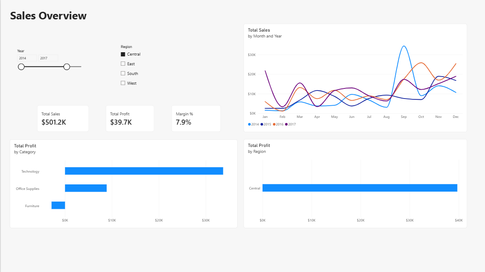
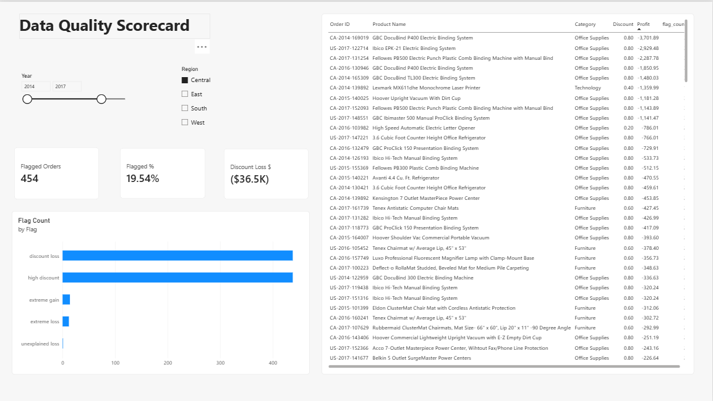

# Sales Data Quality Auditor


## Overview
A Python tool that ingests a sales dataset, runs data quality and
business rule checks, and produces a self-contained HTML report with flagged
issues, detail tables, and a summary scorecard.

Built to mirror real-world data validation workflows — the kind used in sales
operations and compensation environments where bad data directly causes incorrect
payouts or reporting errors.

**Tools used:** Python, pandas, uv, pytest, Ruff, mypy, pre-commit, GitHub Actions, Power BI

---

## What It Does
The auditor runs 11 checks across two categories:

**Data Quality Checks**
- Missing values across all columns
- Fully duplicate rows
- Negative or zero Sales values
- Negative or zero Quantity values
- Discount values outside valid 0–1 range
- Ship Date preceding Order Date

**Business Rule Checks**
- Extreme loss outliers (below 3 standard deviations from mean profit)
- Extreme profit outliers (above 3 standard deviations from mean profit)
- High discount orders (>50%) and their impact on margin
- Discount-driven losses (orders where high discount directly caused negative profit)
- Unexplained losses (significant losses at low discount — potential pricing or cost basis issues)

---

## Sample Output


---

## Key Findings on Superstore Dataset

### 1. Discount Policy is the Primary Driver of Losses
856 orders (8.6% of all transactions) carried discounts above 50%.
Every one of them recorded a loss, totalling $76,559. In this dataset,
discounts above 50% never produced a profitable order.

### 2. Unexplained Losses in Office Supplies
2 high-value orders ($4,663 and $3,930 in Sales) recorded losses above
$500 despite only 20% discounts applied. Both were electric letter opener
SKUs. Losses of this magnitude at modest discount levels suggest potential
cost basis errors or pricing misalignment — not discount policy — and would
warrant investigation with inventory/cost data.

### 3. 37 Extreme Loss Outliers Totalling $58K
Statistical outlier detection (3σ method) flagged 37 orders with losses
beyond 3 standard deviations from mean profit ($28.66 ± $234.26).
The worst single order lost $6,600 on $4,500 in sales (a Cubify CubeX 3D printer at 70% discount, a -147% margin). The next worst, a $7,999 order at 50% discount, lost $3,840 (-48%).

### 4. Data Integrity is Clean
No missing values, duplicate rows, invalid date sequences, or out-of-range
values were found. All quality issues are business rule violations rather
than structural data problems.

### 5. Power BI Dashboard
To make the audit results easier to explore, I built a two-page Power BI
dashboard on top of the auditor's row-level output (`export_flags`).

- **Sales Overview:** sales, profit and margin trends by month, category and region
- **DQ Scorecard:** flagged orders by rule, the profit impact of discount-driven
  losses, and a drill-down table of the worst orders

Built with: Power Query (unpivot of flag columns), a star-schema model with a
date table, and DAX measures (`CALCULATE`, `DIVIDE`).




Open `sales_dq_dashboard.pbix` in Power BI Desktop.

---

## How to Run

This project uses [uv](https://docs.astral.sh/uv/) to manage Python and its packages.

**Set up:**
```bash
git clone https://github.com/AnkitDutta/sales-dq-auditor.git
cd sales-dq-auditor
uv sync
```

**Run the auditor:**
```bash
uv run dq-audit
```

Then open `output/dq_report.html` in any browser.

**Options:**

| Option | What it does | Default |
|---|---|---|
| `--input` | CSV file to audit | `data/superstore.csv` |
| `--output` | Where to save the HTML report | `output/dq_report.html` |
| `--fail-on` | `fail`, `warn` or `never`: when to return exit code 1 | `never` |
| `--version` | Show the version | |

Exit codes: `0` means the run completed, `1` means the `--fail-on` condition
was met, and `2` means an error, such as a missing input file.

**Export row-level flags for the Power BI dashboard:**
```bash
uv run python -m sales_dq_auditor.export_flags
```

This saves `output/superstore_flagged.csv`.

---

## Development

```bash
uv run pytest                # tests, with a 90% minimum coverage
uv run ruff check            # lint
uv run ruff format           # format
uv run mypy                  # strict type checks
uv run pre-commit install    # set up the git hooks (once per clone)
```

The commit hooks run linting, formatting, type and file checks. Tests run before
each push. GitHub Actions runs linting, format checks, type checks and tests.

---

## Project Structure

```
sales-dq-auditor/
├── .github/workflows/ci.yml   # CI pipeline
├── src/sales_dq_auditor/
│   ├── cli.py                 # dq-audit command
│   ├── config.py              # thresholds and paths
│   ├── loader.py              # CSV loading and column validation
│   ├── models.py              # result data classes
│   ├── runner.py              # runs all checks
│   ├── export_flags.py        # row-level flags for Power BI
│   ├── checks/                # data quality and business rules
│   └── report/                # console and HTML output
├── tests/                     # pytest suite
├── data/superstore.csv        # sample dataset
├── baseline/                  # original output, used by a regression test
├── docx/plan.md               # refactor plan
├── images/                    # dashboard screenshots
└── sales_dq_dashboard.pbix    # Power BI dashboard
```
